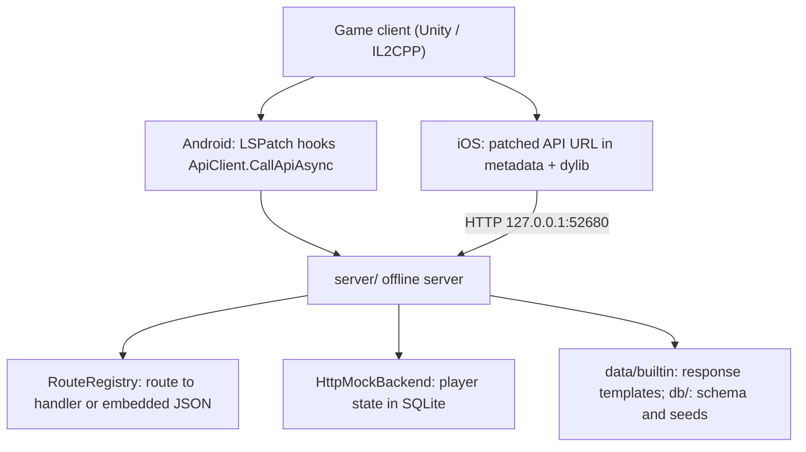

<!-- Translation source: 501289cf3b617f15507c0039ea96fbc2e157595c (docs/zh/architecture.md) -->

# Architecture

## Directories

| Directory | Contents |
|---|---|
| `server/src` | Offline server. `RouteRegistry.cpp` registers routes; `backend/HttpMockBackend.cpp` handles stateful ones (gacha, development, missions, SHOW results, stamina, etc.); `MockPlatform.hpp` abstracts the platform. |
| `server/src/standalone` | Platform implementation independent of Android and a small HTTP server, shared by the iOS dylib and host build. |
| `server/data/builtin` | Embedded response templates (`<接口>.json` and `default.headers`). |
| `server/db` | Embedded schemas (`schema/`), seed data (`seed/`), queries, and player-save migrations (`player-state/`). |
| `server/generators` | Scripts that generate templates and seeds from master data (`third_party/link-like-diff`). |
| `server/host`, `server/tests` | Desktop server and smoke tests. |
| `android/app/src/main/cpp` | Native Android module: `HttpMock.cpp` connects offline responses to the game's request flow; `hooks/` contains offline fixes, protections, and asset-version handling. |
| `android/app/src/main/java` | Kotlin entry point: prepares cache directories, writes storage keys, initializes the native module, and loads embedded configuration. |
| `android/lspatch` | LSPatch used for repacking and a first-launch fix. |
| `ios/` | iOS dylib: starts the offline server, writes storage keys, provides a push-notification placeholder and development-only remote tools. |
| `tools/linkura_offline` | Packaging and installation: iOS patch table, IPA packaging, symbol mapping, Android repacking, and resource packs. |
| `tools/re`, `tools/resources` | Reverse-engineering helpers; cache analysis, decryption, and Android→iOS conversion. |

## Request flow

1. The client calls an API, such as `/v1/home/get_home`.
2. On Android, `ApiClient_CallApiAsync` in `HookShare` intercepts the call and `HttpMock::CreateMockTaskForApiPath` returns a completed Task. On iOS, a local HTTP request reaches the server in the dylib.
3. `RouteRegistry` finds a handler: static routes return an embedded template; stateful routes go to `HttpMockBackend`.
4. Headers come from `default.headers`; the backend fills shared fields such as wallet, stamina, and Chapter rank.
5. Unregistered paths log `no mock file or registered route` on Android or `no route for` on iOS. The client usually displays a communication error. These logs identify new routes to implement.

## Client-side fixes

The server controls responses, but some client behavior also needs changes, such as loading assets that were never saved. Android uses hooks (`hooks/`); iOS uses the static patch table in `tools/linkura_offline/ios_offline.py`. Both platforms aim for the same result. For example, tapping Chapter RANK: Android makes the click state machine read rank 0, while iOS turns the corresponding branch into an unconditional jump.
