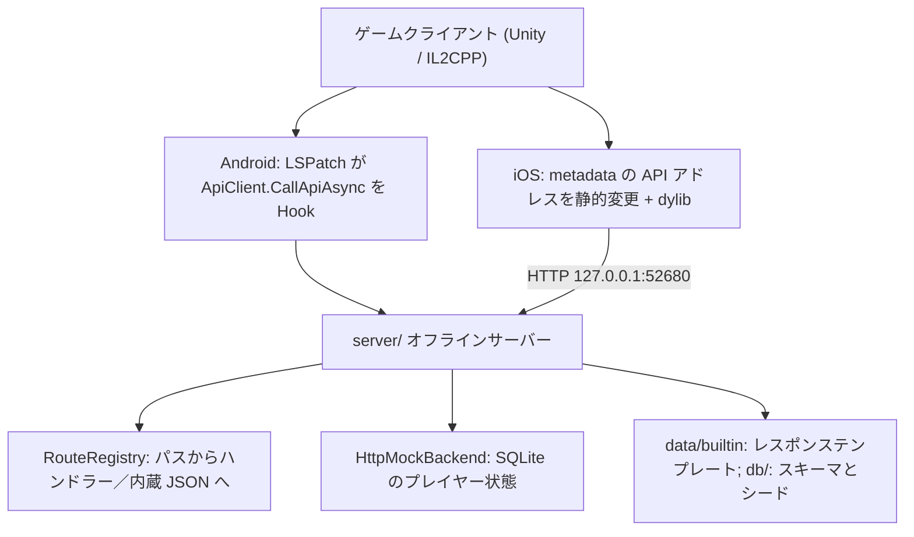

<!-- Translation source: 90518a6248a5ba37092c565288849fabc9dd2310 (docs/zh/architecture.md) -->

# 全体構成

## ディレクトリ

| ディレクトリ | 内容 |
|---|---|
| `server/src` | オフラインサーバーです。`RouteRegistry.cpp` が全 API を登録し、`backend/HttpMockBackend.cpp` が状態を持つ API（ガチャ、育成、ミッション、SHOW の結果、スタミナなど）を実装します。`MockPlatform.hpp` はプラットフォーム抽象です。 |
| `server/src/standalone` | Android に依存しない実装と最小限の HTTP サーバーです。iOS dylib とホスト版で共用します。 |
| `server/data/builtin` | 内蔵レスポンステンプレート（`<API パス>.json`、`default.headers`）です。ビルド時に組み込みます。 |
| `server/db` | スキーマ（`schema/`）、シードデータ（`seed/`）、クエリー、プレイヤーセーブの移行処理（`player-state/`）です。ビルド時に組み込みます。 |
| `server/generators` | マスターデータ（`third_party/link-like-diff`）からテンプレートとシードを生成するスクリプトです。 |
| `server/host`、`server/tests` | デスクトップ版サーバーとスモークテストです。 |
| `android/app/src/main/cpp` | Android のネイティブモジュールです。`HttpMock.cpp` がオフラインレスポンスをゲームのリクエストに接続し、`hooks/` がオフライン修正、保護、アセットバージョンを扱います。 |
| `android/app/src/main/java` | Kotlin の入口です。キャッシュディレクトリの準備、ストレージキーの書き込み、ネイティブモジュールの初期化、内蔵設定の読み込みを行います。 |
| `android/lspatch` | 再パッケージ化用の LSPatch と初回起動時の修正です。 |
| `ios/` | iOS dylib です。オフラインサーバー起動、ストレージキー書き込み、プッシュ通知の代替、開発用リモートツールを含みます。 |
| `tools/linkura_offline` | iOS パッチ表・IPA 作成・シンボル表、Android 再パッケージ化、リソースパックの作成と導入です。 |
| `tools/re`、`tools/resources` | 解析補助、キャッシュ分析・復号・Android→iOS 変換です。 |

## リクエストの流れ

1. クライアントが `/v1/home/get_home` などの API を呼びます。
2. Android では `HookShare` の `ApiClient_CallApiAsync` が呼び出しを捕捉し、`HttpMock::CreateMockTaskForApiPath` が完了済みの Task を返します。iOS ではローカル HTTP リクエストが dylib 内のサーバーに届きます。
3. `RouteRegistry` がハンドラーを探します。静的な API は内蔵テンプレートを返し、状態を持つ API は `HttpMockBackend` に渡します。
4. ヘッダーは `default.headers` から来ます。財布、スタミナ、Chapter rank などの共通フィールドはバックエンドが埋めます。
5. 未登録パスは Android で `no mock file or registered route`、iOS で `no route for` と記録されます。通常、クライアントには通信エラーが出ます。新しい API を追加する手掛かりになります。

アセットのリクエスト（iOS）は別の経路をたどります。ゲームは `http://127.0.0.1:52680/a/<パス>` を要求し、dylib のサーバーはまず `Documents/LinkuraOffline/assets/` を探し、なければ `config.json` の `remoteAssetBase` が示すリモートサーバーに転送します。[リモートアセットサーバー](remote-assets.md)をご覧ください。Android のアセットはすべて、端末に取り込んだリソースパックから読み込みます。

## クライアント側の修正

サーバーが決められるのはレスポンスだけです。保存されていないアセットを読み込もうとするなど、クライアントの動作を変える必要がある場合、Android は `hooks/` の Hook、iOS は `tools/linkura_offline/ios_offline.py` の静的パッチを使います。両者は同じ結果を目指します。たとえば Chapter RANK をタップしたとき、Android はクリック用ステートマシンに rank 0 を読ませ、iOS は対応する条件分岐を無条件分岐に変えます。
