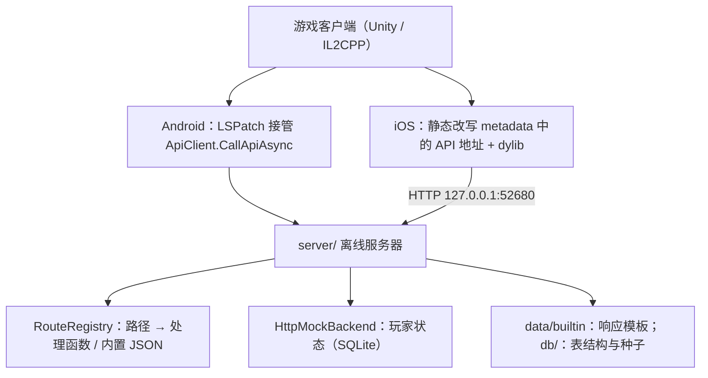

# 架构

## 目录

| 目录 | 内容 |
|---|---|
| `server/src` | 离线服务器。`RouteRegistry.cpp` 注册所有接口；`backend/HttpMockBackend.cpp` 实现需要状态的接口（扭蛋、养成、任务、SHOW 结算、体力等）；`MockPlatform.hpp` 是平台抽象 |
| `server/src/standalone` | 不依赖 Android 的平台实现和一个最小 HTTP 服务器，iOS dylib 和主机版共用 |
| `server/data/builtin` | 内置响应模板（`<接口>.json`、`default.headers`），构建时嵌入 |
| `server/db` | 表结构（`schema/`）、种子数据（`seed/`）、查询、玩家存档迁移（`player-state/`），构建时嵌入 |
| `server/generators` | 从主数据（`third_party/link-like-diff`）生成内置模板和种子的脚本 |
| `server/host`、`server/tests` | 桌面版服务器和冒烟测试 |
| `android/app/src/main/cpp` | Android 原生模块：`HttpMock.cpp`（把离线响应接进游戏的请求流程）、`hooks/`（离线修复、保护、资源版本等） |
| `android/app/src/main/java` | Kotlin 入口：准备缓存目录、写入存储密钥、初始化原生模块、加载内置配置 |
| `android/lspatch` | 封装用的 LSPatch 及首次启动修复 |
| `ios/` | iOS dylib：启动离线服务器、写入存储密钥、推送通知占位、开发用远程工具 |
| `tools/linkura_offline` | 打包与安装：iOS 补丁表和打包、符号表、Android 封装、资源包 |
| `tools/re`、`tools/resources` | 逆向辅助；资源缓存分析、解密和 Android→iOS 转换 |

## 一次请求的路径

1. 客户端调用 API（例如 `/v1/home/get_home`）。
2. Android：`HookShare` 中的 `ApiClient_CallApiAsync` 拦截，`HttpMock::CreateMockTaskForApiPath` 生成一个已完成的 Task；iOS：请求经本机 HTTP 到达 dylib 里的服务器。
3. `RouteRegistry` 找到处理函数：静态的直接返回内置模板，有状态的交给 `HttpMockBackend`。
4. 响应头来自 `default.headers`（钱包、体力、Chapter rank 等通用字段由后端填写）。
5. 未注册的路径记为 `no mock file or registered route`（Android）或 `no route for`（iOS），客户端通常会显示通信错误，这是新增接口的入口线索。

资源请求（iOS）走另一条路：游戏请求 `http://127.0.0.1:52680/a/<路径>`，dylib 的服务器先找 `Documents/LinkuraOffline/assets/`，没有就按 `config.json` 的 `remoteAssetBase` 向远程服务器转发，见 [远程资源服务器](remote-assets.md)。Android 的资源全部来自导入设备的资源包。

## 客户端侧修复

服务器只能决定返回什么。客户端行为本身有问题时（比如去加载从未保存的资源），Android 用 Hook 改（`hooks/`），iOS 用静态补丁改（`tools/linkura_offline/ios_offline.py` 的补丁表）。两边尽量做同一件事，例如 Chapter RANK 点击：Android 在点击状态机里让 rank 读成 0，iOS 把同一个分支改成无条件跳转。
